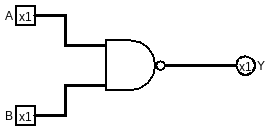
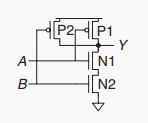
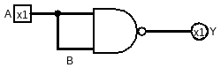
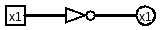
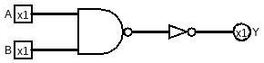
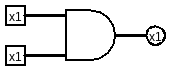
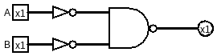
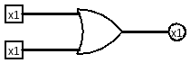
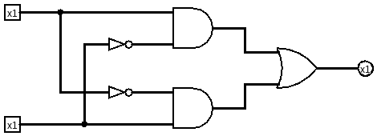
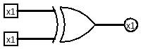

# 基础逻辑门

(电路图均采用https://logisim.app/ 绘制和运行，可打开后加载gates/logic_gates.circ体验)

## NAND

真值表:
|A|B|Y|
|--|--|--|
|0|0|1|
|0|1|1|
|1|0|1|
|1|1|0|

电路图:

实际上的由CMOS连接的电路图：

这个门可以构建很多其他的门，非常强大，下面我们也会这样做，有一门这样的课程展示了这个NAND的威力，链接在: https://www.nand2tetris.org/course

## NOT

真值表:
|A|Y|
|--|--|
|0|1|
|1|0|

看真值表，其实等价于把NAND的真值表的A≠B的两行去掉，只保留A=B的行，即：

|A|B|Y|
|--|--|--|
|0|0|1|
|1|1|0|

在电路图上就是把NAND的 A B 接在一起：

但通常这样表示：

## AND

真值表:
|A|B|Y|
|--|--|--|
|0|0|0|
|0|1|0|
|1|0|0|
|1|1|1|

其实就是把NAND的输出取NOT:

但通常这样表示：

## OR

真值表:
|A|B|Y|
|--|--|--|
|0|0|0|
|0|1|1|
|1|0|1|
|1|1|1|

此处要引入一个东西叫[德摩根定律](https://zh.wikipedia.org/wiki/%E5%BE%B7%E6%91%A9%E6%A0%B9%E5%AE%9A%E5%BE%8B)
即：
- NOT (A AND B) = (NOT A) OR (NOT B)
- NOT (A OR B) = (NOT A) AND (NOT B)

所以我们要的 A OR B = NOT ((NOT A) AND (NOT B)) = NAND(NOT A, NOT B):

但通常这样表示：

## XOR

真值表:
|A|B|Y|
|--|--|--|
|0|0|0|
|0|1|1|
|1|0|1|
|1|1|0|

这个门叫异或门，只有A≠B才输出1
此处引入[sum-of-products](https://www.geeksforgeeks.org/digital-logic/what-is-sum-of-product-sop-form/)，可以直接从真值表获得布尔表达式

Y = ~AB + A(~B)

但通常这样表示：
