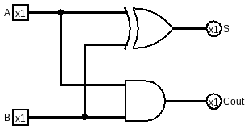
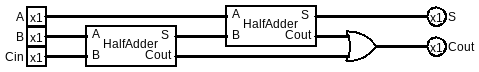
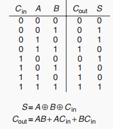
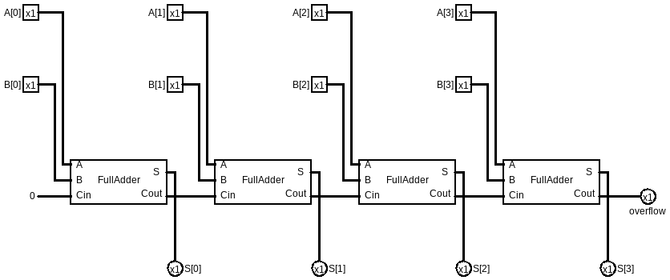
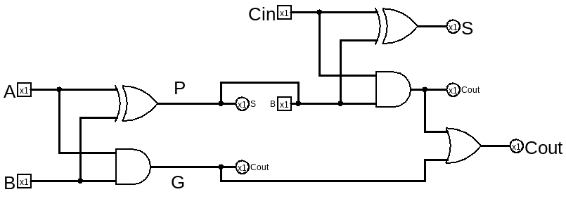
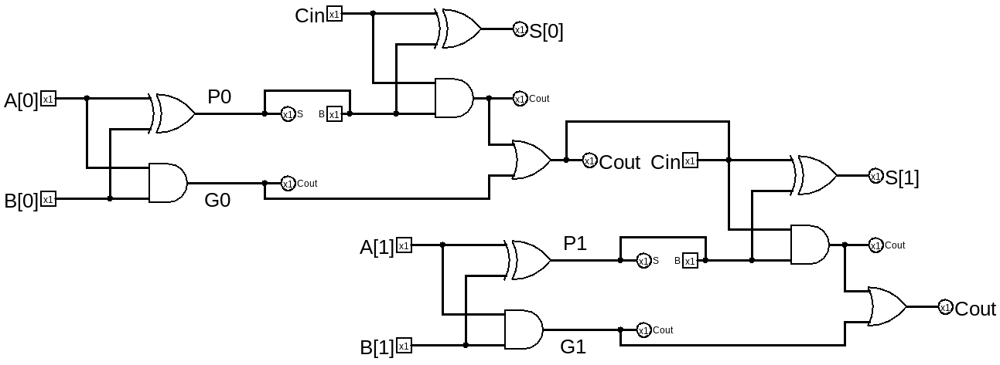
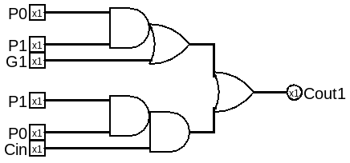
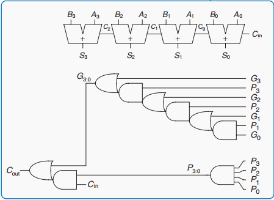

# 加法电路

有了[基础逻辑门](00-基础逻辑门.md)，我们已经可以做加法了。

## 半加器

- 和: S = A ^ B
- 进位: Cout = A & B



为什么叫半加器是因为它没办法处理多位加法，想象我们熟悉的十进制加法，涉及多位加法的时候必须处理进位，而半加器仅输出进位，而没有处理输入的进位。

## 全加器

在做全加器的时候，一个很自然的想法是用两个半加器拼起来，像这样：



但如果我们通过真值表求得的表达式可能是这样的：


注意到 进位 的表达式貌似挺复杂的，如果我们把两个半加器展开以后发现Cout的路径并不是这样的。

将Cout的表达式经过化简：
Cout = AB + (A + B) Cin
把 (A + B) 用OR的真值表 sum-of-product一下，变成：
Cout = AB + (A~B + ~AB + AB) Cin
我们知道 异或 = A~B + ~AB，于是把它抽出来:
Cout = AB + (A~B + ~AB) Cin + AB Cin
Cout = AB(1 + Cin) + (A~B + ~AB) Cin
Cout = AB + (A^B) Cin


## 多位加法

全加器由半加器串联拼接而成，而多位加法就像我们平时算加法一样，把进位往后传递，即多个全加器将进位往后传播，就可以计算多位加法了。这就是**Ripple Carry Adder(RCA)**。

### Ripple Carry Adder（行波进位加法器）



但是，这种朴素的自然的想法是有代价的。问题在于进位传播链路，比如上图中最右边的Cout依赖上一个Cout，而这个Cout又依赖上一个，一直到第一个FA。随着位数加长，传播链路是线性增长，要知道门电路的工作不是瞬间完成的，是有延迟的，假如单个全加器的延迟为tFA，N位全加器的延迟就是 N*tFA。于是出现了一些方法改进。

### Carry Lookahead Adder(CLA, 超前进位加法器)

想法是如果能提前预测到后面的全加器的Cin是什么就好了，能不能做到呢？

要打破进位传播链，就是说要仅依赖输入信号就算出后面的进位，我们把全加器展开研究研究。

全加器：


先看左边的半加器，我在两个输入线标上了G和P，
Cout是靠**左边的半加器的Cout** OR **右边的半加器的Cout** 产生的，即：
Cout = Cout_HA0 + Cout_HA1
而 Cout_HA0 = G = AB, Cout_HA1 = P Cin

- G = AB 的意义是 **只要A和B为1，一定会产生进位**，所以G就是Generate进位的意思；

- P = A ^ B 的意义是 **只要A或B有且只有一个为1，就会把Cin传给Cout，whatever Cin是什么**， 所以P就是Propagate进位的意思。

G和P都是仅靠输入信号A和B表达的式子，用它们来表达Cout能更好的分析问题：
Cout = G + P Cin
进位 就是靠 **生成** 和 **传播**输入进位 产生的。

那我们看看2位全加器的Cout能不能仅靠A B Cin来生成和传播：



Cout[1] = G[1] + P[1] Cin[1]
Cout[1] = G[1] + P[1] Cout[0]
Cout[0] = G[0] + P[0] Cin
所以
Cout[1] = G[1] + P[1] (G[0] + P[0] Cin)
Cout[1] = G[1] + P[1] G[0] + P[1] P[0] Cin

其中G、P、Cin都是已知的输入信号，不再依赖传播。

按照这个思路画一下CLA：



更多位的CLA可以以此规律画：

4位CLA可以这样展开：
```
C1 = G0 + P0·C0
C2 = G1 + P1·G0 + P1·P0·C0
C3 = G2 + P2·G1 + P2·P1·G0 + P2·P1·P0·C0
C4 = G3 + P3·G2 + P3·P2·G1 + P3·P2·P1·G0 + P3·P2·P1·P0·C0
```



（其中P3:0是一个4口与门）

理想的CLA的延迟是O(logN)，但是我们画图时也可以感受到它占的面积是比较大的，因此没有最好的设计，只有最适合的，要看我们的目标是什么（面积/功耗/性能）

---
**前缀加法器(Prefix Adder)** 是 CLA 思想的一般化和结构化实现，也是现代高性能加法器的主流方案。它把“并行算进位”这件事抽象成一个前缀计算问题，用树形结构来组织，连线复杂，这里我们按下不表。
