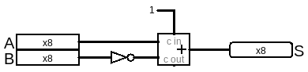

# 用加法器做减法

本章电路保存在[../gates/sub.circ](../gates/sub.circ)

减法其实是负数的加法，A - B = A + (-B)，如此一来我们只要有办法表示负数即可通过加法实现减法。

在计算机中是用补码表示负数的，改变符号就是原来的二进制取反加1，比如 -3 是 3的二进制 0011 取反(1100) 加 1 = 1101。可以验一下 -3 + 3 是不是等于0：
```
     0011
+    1101
= (1)0000
```

那么这个电路就比较简单了：


