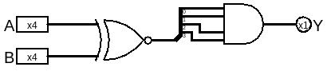
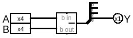
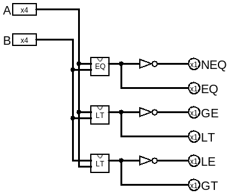

# 比较器

有了减法我们就可以做比较器了，比较器是用来对两个输入比较大小的，比较结果包含 等于、大于、大于等于、小于等6种情况。

本章的logisim电路在[../gates/comparators.circ](../gates/comparators.circ)

## EQ(Equal, 等于比较)

逐位比较是否等于的真值表:
|A|B|Y|
|--|--|--|
|0|0|1|
|0|1|0|
|1|0|0|
|1|1|1|

其实就是XNOR(同或)
对于多位的比较，还要看XNOR的输出是否全为1才能确定是否全等。

## LT(Less Than, 小于比较)

小于可以通过减法器实现，当A - B < 0的时候，证明A < B

## 完整的比较器

有了EQ和LT就可以做出全部的比较路径了。

- NEQ: 不等于
- EQ:  等于
- GE:  大于等于
- LT:  小于
- LE:  小于等于
- GT:  大于