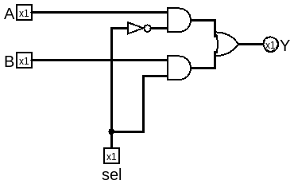
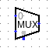
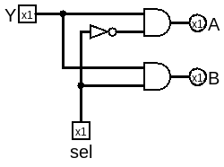

# 选择器

想要在门电路层面实现类似if/else, switch/case的功能，这就需要选择器，选择器应该要有多个输入信号、一个选择信号和一个输出信号。

本章的logisim电路在[../gates/mux.circ](../gates/mux.circ)

## MUX

两路选择器的真值表应该是这样的：
|A|B|sel|Y|
|--|--|--|--|
|x|x|0|A|
|x|x|1|B|

布尔表达式：
Y = ~sel A + sel B

电路图：

在内置元件库中长这样：

能选择的输入信号个数与sel的位宽有关，具体来说 输入信号个数 = 2 ^ sel位宽， 4位输入需要2位的sel。

## DEMUX

如果把MUX的输入和输出反过来，就可以把一路信号按需分配到对应的输出位置，这就是分配器。

两路分配器的真值表类似于这样：
|Y|sel|A|B|
|--|--|--|--|
|x|0|Y|x|
|x|1|x|Y|

布尔表达式：
A = ~sel Y
B = sel Y

电路图：

