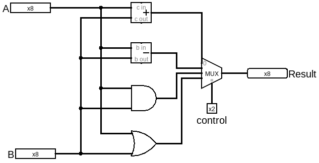

# ALU

前面介绍的逻辑门和运算门都是双目运算，接下来我们做一个器件把几个操作的结果通过分配器输出，这样我们想要哪种运算结果就只要设置对应的选择信号即可。这就是ALU（Arithmetic/Logical Unit，算术逻辑单元）

本章的logisim电路在[../gates/alu.circ](../gates/alu.circ)

接下来我们缝合的四个操作以及对应的选择信号如下：
|ALUControl|Function|
|--|--|
|00|Add|
|01|Subtract|
|10|AND|
|11|OR|

电路图：

如果需要更多类型的操作，只要继续加入操作门和按需增加MUX的位宽就行。

control就是用于选择要什么操作的结果，类似于计算器上按加减乘除的感觉，这就是所谓的指令（instruction）。