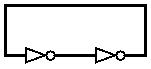
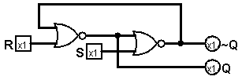
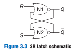
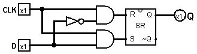
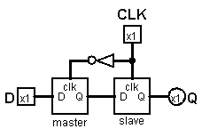
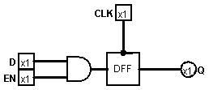
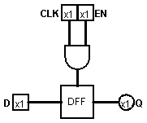

# 锁存器和触发器

有了ALU，我们就能做一些简单计算，但是有个问题，没有东西可以记住中间结果，比如我们要用ALU计算 1 + 2 + 4，先计算1 + 2，得到3， 再计算3 + 4，得到7 。中间得到的3就要暂时放到别的地方，目前我们是通过自己的脑子记住，我们想让硬件也有这种功能。

我们先来看这样的一个奇怪的电路：

由于双重否定表肯定，假如左边的NOT一开始输入0，右边的NOT也是输出0；如果输入1则输出1。
看起来输入就像被“锁”在了这个电路中。

但是这个电路有个很明显的问题：无法设置输入信号。

## SR锁存器

我们用NOR替换上面的NOT就可以输入信号了，变成这样：

一般在教科书上会这样画：  

NOR门的特性是，只要有一个输入为1就输出0

因此当R = S = 0的时候，这个电路就相当于两个NOT相连的情况，这时候数据就被锁住了。我们再来分析其它情况：

|R|S|Q|~Q|
|--|--|--|--|
|0|0|Qprev|Qprev|
|0|1|1|0|
|1|0|0|1|
|1|1|0|0|

看来R的作用是Reset，将Q清零；S的作用是置位，将Q设为1  
然而看真值表的最后一行貌似有问题，Q和~Q居然都是0，会有冲突，为了解决这个问题，R和S应该不能同时为1，于是我们引入D锁存器。

## D锁存器

想让R和S不能同时为1，可以让D表示S，D取反表示R，可是我们还需要R=S=0的情况，那我们可以让D或者D取反的结果与上一个控制信号，在这里用CLK表示，它其实是一个时钟信号。

不过D锁存器也有它的问题，当CLK为1的时候，Q会随着D随时变化，在使用的时候要注意。

## D触发器

为了解决D锁存器在CLK为1时的数据竞争问题，引入D触发器，让数据只能在时钟跳变的边缘写入，其它时候保持。

D触发器可以通过两个D锁存器级联而成，一个为主机一个为从机：

在CLK由0变1的过程中，有某一个边缘时刻master和slave的clk都判定为1，此时两个锁存器都设为了D，而其它时候两个锁存器只会有一个是能写入的，D透传不到Q。

这是实际上更常用的记忆单元。

## 带使能的D触发器

使能信号EN控制输入是否能被更新进去。

注意，有个错误的做法是把EN与上CLK，像这样：

