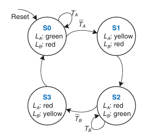
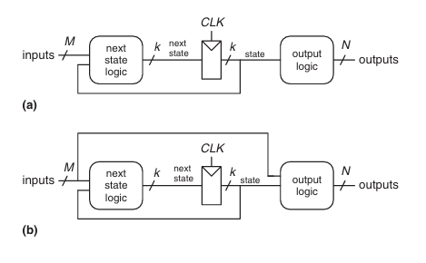
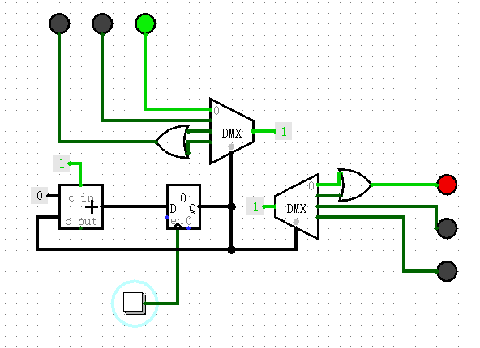

# 状态机

前人为了解决组合逻辑电路和时序逻辑电路同时存在时的分析和设计问题，引入了状态图，如图：

其中：
- 圈圈表示状态种类，图中有4个状态
- 箭头表示状态转移
- 箭头上的文字表示状态转移条件
- 圈圈里的文字表示该状态的输出

状态机本身也分成了两种类型，区别只是输出是否依赖输入：

- Moore状态机：输出只依赖当前状态
- Meele状态机：输出既依赖当前状态，也依赖输入

状态一般存储在寄存器中，可以随着时钟信号发生改变，就能随着时间变化输出。以一个简单的交通灯控制电路为例：

电路在[../gates/tracfic_light.circ](../gates/tracfic_light.circ)

南北方向 和 东西方向 各有红黄绿色的交通灯，时钟信号通过下方的按钮模拟，共有4种状态，每种状态对应的交通灯颜色如下：

- S0: 南北绿，东西红
- S1: 南北黄，东西红
- S2: 南北红，东西绿
- S3: 南北红，东西黄

有了状态机，就可以让电路自己“记住”一些东西，并根据记住的状态调整自身的功能。