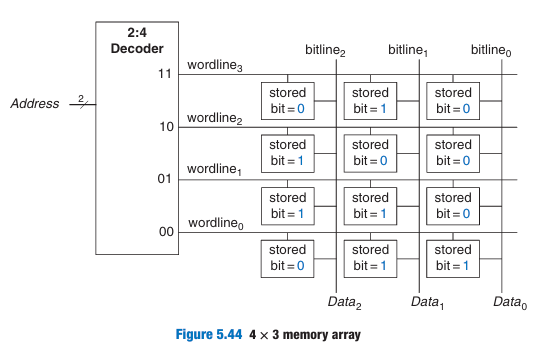
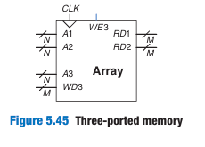
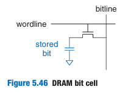
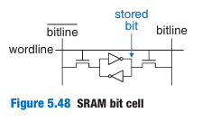
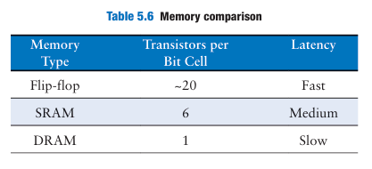
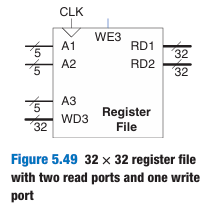

# 内存

## 组织方式

很多个寄存器按照一定组织方式连接起来就是内存阵列，一般的组织方式是这样的：

内存的宽度(width)定义为一行有多少个位寄存器，在这里是3个，也叫做字长。
内存的深度(depth)定义为有多少行字，在这里深度为4.

## 端口

一般内存都会有多个端口，分为读口和写口，图为一个两读一写的内存。

## 分类

大分类是RAM(Random Access Memory)和ROM(Read Only Memory)
- RAM是易失的(volatile)，掉电的话数据就没了
- ROM是不易失的(nonvolatile)，即使掉电数据也还在

实际上RAM和ROM的英文全称已经过时了，因为ROM也是Random access的，random access的含义是访问每个字的延迟都是相同的。而且现代的ROM也已经不是Read-only了，而是可读可写的。

ROM有很多细分类，区别在于如何写和擦除。

RAM又能分为两类：
- DRAM(Dynamic RAM): 通过给电容充电来存储比特位，读数据的时候要把电给吸出来，所以需要重新充电（刷新）。而且电容本身也会漏电，即使不读不写，DRAM本身也需要时不时的充电。
- SRAM(Static RAM): 不同于DRAM，SRAM存储的比特位是不需要刷新的，存储在一个对偶的反相器对。

DRAM bit cell：

SRAM bit cell:

## 面积和延迟

触发器、SRAM和DRAM都是易失内存，它们有着不同的面积和延迟特性，具体如下表：

## 寄存器堆

寄存器堆(Register files)通常用来存储处理器需要的临时值，一般用SRAM来做，比DRAM快，比触发器省面积。

图为一个32x32的寄存器堆，两读一写，可同时读写：

一般第1个字还会硬连线为0，因为这是个很常用的常量，直接读0就相当于拿到0值。