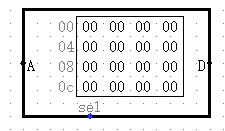
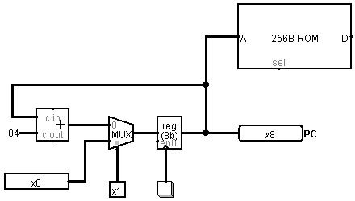

# 程序计数器(PC)

程序是指令的组合，指令是比特位的组合，一般都装在内存中，RV32I的指令是固定的32bit，假设我们把指令放在这样的一个ROM里：

ROM的地址是8位，数据宽度是8位，意味着每个地址对应取一个8位数据，总共能寻址256个字节。

我们将设计一个程序计数器（PC）用于在ROM中取走指令。

指令是32bit的，也就是说当我们想要取下一条指令的时候，应该要让地址往后走4格，或者说地址应该能除尽4（4字节对齐）

指令可能是逐条向下执行的，也可能突然跳到别的地方执行（函数调用或者for循环），所以PC应该设计成既能接收外来的地址，也能自增。

类似于这样：

